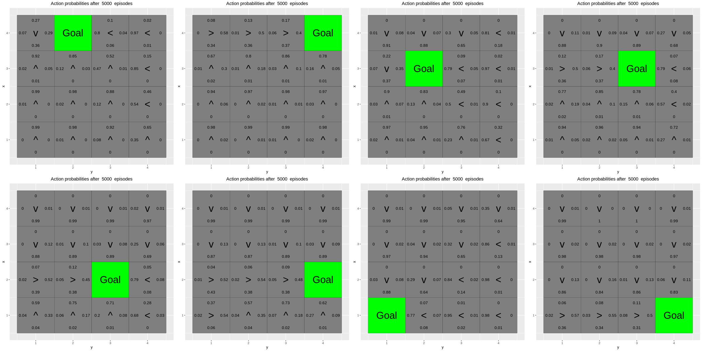
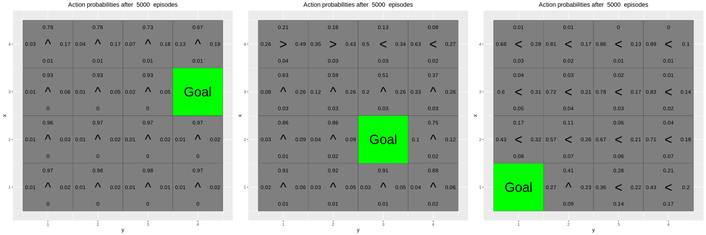

```{r setup, include=FALSE}
knitr::opts_chunk$set(echo = FALSE, message = FALSE, warning = FALSE,
                      fig.width = 7, fig.height = 4.5, fig.align = "center")
```

```{r functions, include=FALSE}
# Shared Q-learning machinery used by environments A, B and C.
# State = (x, y) with x = row (1..H, plotted upwards), y = column (1..W).
# Q-table layout: q_table[x, y, action], an H x W x 4 array.
# Action indices: 1 = up, 2 = right, 3 = down, 4 = left (clockwise order,
# so action +/- 1 (mod 4) is a perpendicular action).
set.seed(12345)
library(ggplot2)

# Arrow symbols and (dx, dy) moves, indexed by action number.
arrows <- c("^", ">", "v", "<")
action_deltas <- list(c(1,0), # up
                      c(0,1), # right
                      c(-1,0), # down
                      c(0,-1)) # left

# Plot the grid (given code): the four Q-values per non-terminal cell
# (top/right/bottom/left = up/right/down/left), the greedy action as an
# arrow, and fill colour = max_a Q (red NA cells = negative rewards).
# Uses globals H, W, reward_map and q_table.
vis_environment <- function(iterations=0, epsilon = 0.5, alpha = 0.1, gamma = 0.95, beta = 0){
  # expand.grid: data frame with one row per (x, y) cell (x varies fastest).
  df <- expand.grid(x=1:H,y=1:W)
  # mapply applies f(x, y) over the paired df$x, df$y columns; NA = terminal.
  foo <- mapply(function(x,y) ifelse(reward_map[x,y] == 0,q_table[x,y,1],NA),df$x,df$y)
  df$val1 <- as.vector(round(foo, 2))
  foo <- mapply(function(x,y) ifelse(reward_map[x,y] == 0,q_table[x,y,2],NA),df$x,df$y)
  df$val2 <- as.vector(round(foo, 2))
  foo <- mapply(function(x,y) ifelse(reward_map[x,y] == 0,q_table[x,y,3],NA),df$x,df$y)
  df$val3 <- as.vector(round(foo, 2))
  foo <- mapply(function(x,y) ifelse(reward_map[x,y] == 0,q_table[x,y,4],NA),df$x,df$y)
  df$val4 <- as.vector(round(foo, 2))
  foo <- mapply(function(x,y)
    ifelse(reward_map[x,y] == 0,arrows[GreedyPolicy(x,y)],reward_map[x,y]),df$x,df$y)
  df$val5 <- as.vector(foo)
  foo <- mapply(function(x,y) ifelse(reward_map[x,y] == 0,max(q_table[x,y,]),
                                     ifelse(reward_map[x,y]<0,NA,reward_map[x,y])),df$x,df$y)
  df$val6 <- as.vector(foo)

  # print() needed: ggplot objects are not auto-drawn inside a function/loop.
  # aes maps column y to the horizontal and row x to the vertical axis.
  print(ggplot(df,aes(x = y,y = x)) +
          # Continuous fill white -> green; NA cells drawn red; no legend title.
          scale_fill_gradient(low = "white", high = "green", na.value = "red", name = "") +
          # One filled square per cell, coloured by val6 (max Q / reward).
          geom_tile(aes(fill=val6)) +
          # nudge_x/y shift labels towards a cell edge; na.rm drops NA labels.
          geom_text(aes(label = val1),size = 3,nudge_y = .35,na.rm = TRUE) +
          geom_text(aes(label = val2),size = 3,nudge_x = .35,na.rm = TRUE) +
          geom_text(aes(label = val3),size = 3,nudge_y = -.35,na.rm = TRUE) +
          geom_text(aes(label = val4),size = 3,nudge_x = -.35,na.rm = TRUE) +
          geom_text(aes(label = val5),size = 8) +
          # Transparent tiles with black borders draw the grid lines.
          geom_tile(fill = 'transparent', colour = 'black') +
          ggtitle(paste("Q-table after ",iterations," iterations\n",
                        "(epsilon = ",epsilon,", alpha = ",alpha,"gamma = ",gamma,", beta = ",beta,")")) +
          # hjust = 0.5 centres the title.
          theme(plot.title = element_text(hjust = 0.5)) +
          # Integer tick marks at every column / row.
          scale_x_continuous(breaks = c(1:W),labels = c(1:W)) +
          scale_y_continuous(breaks = c(1:H),labels = c(1:H)))
}

# Greedy policy: return argmax_a Q(x, y, a).
GreedyPolicy <- function(x, y){
  # Break ties at random among the actions with maximal Q-value.
  # (which.max would always pick the first, e.g. always "up" while all
  # Q-values are still 0, biasing the agent.)
  q <- q_table[x,y,]
  best <- which(q == max(q))
  return(best[sample(length(best), 1)])
}

# Epsilon-greedy policy: with probability epsilon explore (uniformly random
# action, which may also be the greedy one), otherwise exploit (greedy).
EpsilonGreedyPolicy <- function(x, y, epsilon){
  if(runif(1) < epsilon){
    return(sample(1:4,1))
  } else{
    return(GreedyPolicy(x,y))
  }
}

# Environment dynamics. beta = slip probability: with prob 1 - beta the
# intended action is executed, with prob beta/2 each the agent slips to
# one of the two perpendicular actions. Returns the new state (x, y).
transition_model <- function(x, y, action, beta){
  # delta = -1 (slip counter-clockwise), 0 (no slip), +1 (clockwise).
  delta <- sample(-1:1, size = 1, prob = c(0.5*beta,1-beta,0.5*beta))
  # Rotate the action by delta, wrapping around within 1..4.
  final_action <- ((action + delta + 3) %% 4) + 1
  # [ ] on a list returns a sub-list; unlist turns it into the c(dx, dy).
  foo <- c(x,y) + unlist(action_deltas[final_action])
  # Clamp to the grid: moving into a wall leaves the agent in place.
  foo <- pmax(c(1,1),pmin(foo,c(H,W)))
  return (foo)
}

# Run one episode of Q-learning from start_state, updating the global
# q_table in place (<<-). Behaviour policy: epsilon-greedy; target: greedy
# (max over next actions), i.e. off-policy. alpha = learning rate,
# gamma = discount, beta = slip probability.
# Returns c(reward of the episode, sum of TD errors).
q_learning <- function(start_state, epsilon = 0.5, alpha = 0.1, gamma = 0.95,
                       beta = 0){
  current_state <- start_state
  # Sum of TD errors over the episode: how much the Q-table was corrected.
  # Tends to 0 as the Q-values converge.
  episode_correction <- 0

  repeat{
    # Follow policy, execute action, get reward.
    next_action <- EpsilonGreedyPolicy(current_state[1], current_state[2], epsilon)
    next_state <- transition_model(current_state[1], current_state[2], next_action, beta)
    q_old <- q_table[current_state[1], current_state[2], next_action]
    reward <- reward_map[next_state[1], next_state[2]]

    # Q-table update (TD update):
    # Q(s,a) <- Q(s,a) + alpha * (r + gamma * max_a' Q(s',a') - Q(s,a)).
    # Terminal states have Q = 0 (never updated), so target = r there.
    target <- reward + gamma * max(q_table[next_state[1], next_state[2],])
    q_table[current_state[1], current_state[2], next_action] <<- q_old + alpha * (target - q_old)
    episode_correction <- episode_correction + (target - q_old)

    current_state <- next_state

    # Any non-zero reward (positive goal or negative state) is terminal.
    if(reward!=0)
      # End episode.
      return (c(reward,episode_correction))
  }
}

# Moving average over windows of n episodes (via cumulative sums), used to
# smooth the reward and correction curves.
MovingAverage <- function(x, n){
  cx <- c(0,cumsum(x))
  # Window sum = S[i+n] - S[i]; returns length(x) - n + 1 averages.
  rsum <- (cx[(n+1):length(cx)] - cx[1:(length(cx) - n)]) / n
  return (rsum)
}
```

# 2.1. Q-learning

*Implementation:* Implemented the greedy policy (argmax of Q with random tie-breaking), epsilon-greedy on top of it, the slippery transition model (intended move with probability $1-\beta$, each perpendicular move with $\beta/2$, walls keep the agent in place) and the update $Q(s,a) \leftarrow Q(s,a) + \alpha(r + \gamma \max_{a'} Q(s',a') - Q(s,a))$; an episode ends at the first non-zero reward.

The Q-learning code (epsilon-greedy policy, transition model and the temporal-difference update) is listed in the appendix.

## 2.2 Environment A

*Implementation:* The Q-table is initialised to 0 and trained for 10000 Q-learning episodes from (3,1) with $\epsilon = 0.5$, $\alpha = 0.1$, $\gamma = 0.95$, $\beta = 0$; it is plotted after episodes 10, 100, 1000 and 10000.

The agent starts in (3,1), the goal (+10) is at (3,6) and the states (2,3), (3,3) and (4,3) give -1. The Q-table after 10, 100, 1000 and 10000 episodes is shown below.

```{r envA, fig.height=4}
# Environment A: 5 x 7 grid, goal +10 at (3,6), wall of -1 at (2:4,3).
# Default parameters (epsilon 0.5, alpha 0.1, gamma 0.95, beta 0).
H <- 5
W <- 7

reward_map <- matrix(0, nrow = H, ncol = W)
reward_map[3,6] <- 10
reward_map[2:4,3] <- -1

# Q-table starts at 0 for all states and actions.
q_table <- array(0,dim = c(H,W,4))

# 10000 episodes from (3,1); plot the Q-table at 10, 100, 1000, 10000.
for(i in 1:10000){
  foo <- q_learning(start_state = c(3,1))
  if(any(i==c(10,100,1000,10000)))
    vis_environment(i)
}
```

**What has the agent learned after the first 10 episodes?**
Almost nothing. Most Q-values are still 0. The few that changed are mainly small negative values for moves into the -1 states near the start, plus a small positive value next to the goal if it was reached.

**Is the final greedy policy optimal for all states?**
No. States on the common paths from the start are visited often and get the right action, but states that are rarely visited get few updates, so their greedy action can be wrong. Q-learning is off-policy TD control: the target uses $\max_{a'} Q(s',a')$, so it estimates the optimal $Q^*$ (the greedy policy) while behaving epsilon-greedily. It is only guaranteed to converge to $Q^*$ if every state-action pair is visited infinitely often and the step sizes satisfy the Robbins-Monro conditions ($\sum_t \alpha_t = \infty$, $\sum_t \alpha_t^2 < \infty$). The first condition is hard to satisfy in practice: the agent always starts in (3,1), so states away from the usual paths are rarely visited within 10000 episodes. (A constant $\alpha = 0.1$ also does not strictly satisfy the second.)

**Do the Q-values reflect the multiple paths to the goal?**
Not really. The environment is symmetric, so under $Q^*$ both routes are equally long and the start state would have equal values for up and down. The learned Q-table mostly reflects one route (above or below the -1 states). Once one route looks slightly better the agent uses it more, so it gets updated more and the other route lags behind. More exploration (higher epsilon, more episodes or random start states) would make both paths show up.

## 2.3 Environment B: effect of epsilon and gamma

*Implementation:* For each combination of $\epsilon \in \{0.5, 0.1\}$ and $\gamma \in \{0.5, 0.75, 0.95\}$ (with $\alpha = 0.1$, $\beta = 0$), a fresh zero Q-table is trained for 30000 episodes from (4,1); reward and correction (sum of TD errors per episode) are smoothed with a 100-episode moving average.

The top and bottom rows give -1, there is a +5 at (4,5) and a +10 at (4,8). The agent starts in (4,1). For each setting the Q-table is shown together with the moving average of the reward and of the correction.

```{r envB, fig.height=4}
# Environment B: 7 x 8 grid, -1 in top and bottom rows, +5 at (4,5)
# (close) and +10 at (4,8) (far, behind the 5). Start in (4,1).
H <- 7
W <- 8

reward_map <- matrix(0, nrow = H, ncol = W)
reward_map[1,] <- -1
reward_map[7,] <- -1
reward_map[4,5] <- 5
reward_map[4,8] <- 10

# Grid search: epsilon (exploration) x gamma (discount); fresh Q-table
# and 30000 episodes per setting.
for(eps in c(0.5, 0.1)){
  for(j in c(0.5,0.75,0.95)){
    q_table <- array(0,dim = c(H,W,4))
    # Per-episode reward and correction (sum of TD errors).
    reward <- numeric(30000)
    correction <- numeric(30000)

    for(i in 1:30000){
      foo <- q_learning(epsilon = eps, gamma = j, start_state = c(4,1))
      reward[i] <- foo[1]
      correction[i] <- foo[2]
    }

    setting <- paste("epsilon =", eps, ", gamma =", j)
    vis_environment(i, epsilon = eps, gamma = j)

    # Moving averages (window 100): reward shows which goal is reached,
    # correction shows when the Q-table stops changing.
    # par(mfrow): 1 x 2 panel layout for the two base plots (reset below).
    par(mfrow = c(1,2))
    # type = "l": line plot; cex.main shrinks the title.
    plot(MovingAverage(reward,100), type = "l", main = paste("Reward,", setting),
         xlab = "Episode", ylab = "Avg reward (last 100)", cex.main = 0.8)
    plot(MovingAverage(correction,100), type = "l", main = paste("Correction,", setting),
         xlab = "Episode", ylab = "Avg correction (last 100)", cex.main = 0.8)
    par(mfrow = c(1,1))
  }
}
```

**Observations.**
With gamma = 0.5 and 0.75 the agent goes for the closer 5, since the discounted value of the farther 10 is lower. From the start the 5 is 4 steps away and the 10 about 9 steps (the agent has to walk around the 5), so the values are roughly 5·gamma^3 vs 10·gamma^8: 0.63 vs 0.04 for gamma = 0.5, 2.11 vs 1.0 for gamma = 0.75, and 4.29 vs 6.63 for gamma = 0.95. So with gamma = 0.95 the 10 is worth the detour and the agent goes around the 5 to reach it (given enough exploration, see below). The Q-values along the path also shrink by a factor gamma per step away from the reward. In general gamma trades short-term against long-term reward, with an effective horizon of about $1/(1-\gamma)$ steps: 2, 4 and 20 here, so only gamma = 0.95 looks far enough ahead to value a reward 9 steps away.

With epsilon = 0.1 the agent explores less. For gamma = 0.5 and 0.75 this hardly matters, since the 5 is the best target anyway, and the average reward settles around 5 with fewer random steps into the -1 rows. But for gamma = 0.95 the agent never discovers the 10: getting past the 5 requires several exploratory moves in a row, so the Q-values on the far side stay 0 and it keeps taking the 5. With epsilon = 0.5 and gamma = 0.95 the agent eventually finds the 10 (around episode 7500), the average reward jumps to about 6.5, and the correction shows a spike while the Q-table is updated towards the new route before dropping back towards 0. So low exploration gives a stable but potentially sub-optimal policy, and enough exploration is needed together with a high gamma to find the better reward. This is the exploration-exploitation trade-off. Since Q-learning is off-policy, epsilon does not change what the values converge to ($Q^*$), only which state-action pairs get visited and hence learned.

## 2.4 Environment C: effect of beta

*Implementation:* For each $\beta \in \{0, 0.2, 0.4, 0.66\}$ a fresh zero Q-table is trained for 10000 episodes from (1,1) with $\epsilon = 0.5$, $\alpha = 0.1$, $\gamma = 0.6$, and the final Q-table is plotted.

The agent starts in (1,1), the states (1,2)-(1,5) give -1 and the goal (+10) is at (1,6). We use epsilon = 0.5 and gamma = 0.6 and vary beta.

```{r envC, fig.height=3}
# Environment C: 3 x 6 grid, -1 at (1,2:5) (a "cliff"), goal +10 at
# (1,6). Start in (1,1), epsilon 0.5, gamma 0.6.
H <- 3
W <- 6

reward_map <- matrix(0, nrow = H, ncol = W)
reward_map[1,2:5] <- -1
reward_map[1,6] <- 10

# Vary beta (slip probability); fresh Q-table, 10000 episodes each.
for(j in c(0,0.2,0.4,0.66)){
  q_table <- array(0,dim = c(H,W,4))
  for(i in 1:10000)
    foo <- q_learning(gamma = 0.6, beta = j, start_state = c(1,1))
  vis_environment(i, gamma = 0.6, beta = j)
}
```

**Observations.**
With beta = 0 there is no slipping, so the agent takes the shortest path along row 2, right next to the -1 states, and the Q-values decay by gamma = 0.6 per step (10, 6, 3.6, 2.16, ...). It does so although epsilon = 0.5 often makes it fall in during training: the off-policy target assumes greedy behaviour and ignores exploration risk (on-policy SARSA would learn a safer path, cf. cliff walking). With beta = 0.2 the route is mostly the same, but the Q-values are lower and moves next to the -1 states get negative values, since slipping into them is now possible. With beta = 0.4 and 0.66 the agent avoids row 2 and moves up to row 3, taking a longer but safer path. In the start state it can even choose "left" into the wall: it then only moves if it slips, and the slips go up (safe) or down (wall), so it can never slip right into the -1. Overall, higher beta gives lower Q-values and a more cautious policy that trades path length for safety. This is because Q-learning learns expected returns: the expected penalty of walking next to the -1 states grows with beta until a detour is worth more.

# 2.5 REINFORCE

The code and results are in `RL_Lab2_Colab.ipynb`. The policy is a neural network (two hidden layers with 32 units) with input (x, y, goal x, goal y) and output the probability of each of the four actions.

REINFORCE is a policy-gradient method: instead of learning action values, it parameterizes the policy $\pi_\theta(a|s)$ directly and does gradient ascent on the expected return $J(\theta)$, using $\nabla_\theta J = E[G_t \nabla_\theta \log \pi_\theta(a_t|s_t)]$, where $G_t$ is the discounted return from step $t$. It is on-policy and Monte Carlo: an episode is sampled with the current policy, then each taken action is made more likely in proportion to the return that followed it (unbiased but high variance). The ability to generalize to goal positions never seen in training comes from this representation, not from REINFORCE as such: the network takes the goal as input and shares its weights across all inputs. A tabular policy trained with REINFORCE would not generalize.

*Note: targets.* Monte Carlo methods such as REINFORCE update towards the actual return $G_t$ of a full episode, which is unbiased but has high variance. Q-learning bootstraps: its target $r + \gamma \max_{a'} Q(s', a')$ uses the current estimate, which gives lower variance but bias while $Q$ is still wrong, and it can update after every step. Both are model-free, so neither needs the transition model; dynamic programming (value or policy iteration) does.

## 2.6 Environment D

Eight goals are used for training and the other eight for validation. The validation results after 5000 episodes are shown below.

```{r envD-img, out.width="100%"}
# Embed an existing image file in the knitted output.

```

**Has the agent learned a good policy?**
Mostly yes. For the validation goals, which were never used in training, the arrows point toward the goal in almost all states. The probabilities are high far from the goal (around 0.85-0.99) and more spread out near it (around 0.4-0.6). The network has learned to use the goal coordinates, so it generalizes to new goals, since the training goals cover the whole grid.

**Could Q-learning have been used?**
Not tabular Q-learning, in this setup. Without the goal in the state it learns one fixed goal. With the goal added to the state ($16 \times 16 = 256$ states) tabular Q-learning would work if all 16 goals were used in training, but each (position, goal) pair is a separate table entry, so the entries for the validation goals would never be trained. The neural network can generalize to unseen goals; a table cannot. (Q-learning with a neural network as Q-function approximator, e.g. DQN, taking the goal as input, could in principle generalize in the same way.)

## 2.7 Environment E

All training goals are in the top row, and the validation goals (3,4), (2,3) and (1,1) are in the rows below.

```{r envE-img, out.width="100%"}

```

**Has the agent learned a good policy?**
No. Since all training goals are in the top row, the agent mostly learned to go up, plus left/right along the top. It does not use the goal's row. For the validation goals it fails: for goal (3,4) the top row points up into the wall, for goal (2,3) the states below it point up past the goal, and for goal (1,1) most states point left but not down.

**Why do the results for D and E differ?**
In D the training goals cover the whole grid, so the network learns how the goal coordinates relate to the best action. In E the goal's row is always 4, so the network never sees that coordinate vary and cannot learn what it means. It only generalizes to goals similar to the ones it was trained on. Function approximation interpolates within the training data but extrapolates poorly, so the coverage of the training goals decides how well the policy generalizes.

# Appendix: R code

```{r ref.label=c("functions", "envA", "envB", "envC"), echo=TRUE, eval=FALSE}
```
